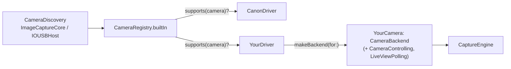

# Adding a camera maker

Mirrorup's capture engine, app and CLI never name a camera maker. Everything vendor-specific lives in
one driver module per maker, found through `CameraRegistry`. This page is the checklist for adding
one (Nikon, Sony, Fujifilm, Panasonic, …) or another Canon family.



## 1. Create the module

- `Sources/Mirrorup<Maker>/`, a target in `Package.swift` depending on `MirrorupPTP`,
  `MirrorupCapture`, `MirrorupDevices` and `MirrorupDiagnostics`. Never on another driver.
- List the driver in `Sources/MirrorupCameras/BuiltInDrivers.swift` and add the module to
  `MirrorupCameras`' dependencies. Order matters only if two drivers claim the same device.
- Vendor opcodes, property codes and value tables stay in your module (`MirrorupPTP` is
  ISO 15740 only). Follow `CanonCatalog`: every code you decode gets a human name and a provenance
  comment; undocumented codes are kept with `isDocumented == false`, never guessed.

## 2. The driver (`CameraDriver`)

```swift
public struct NikonDriver: CameraDriver {
    public var id: String { "nikon" }
    public var name: String { "Nikon" }
    public func supports(_ camera: DiscoveredCamera) -> Bool {
        camera.usbVendorID == 0x04B0 && camera.acceptsPTP
    }
    public func makeBackend(for camera: DiscoveredCamera) async throws(CameraError) -> any CameraBackend {
        NikonCamera(session: try await camera.openPTPSession(), identity: camera.identity)
    }
    public var ptpNames: PTPCodeNames { /* NikonCatalog lookups over PTPCatalog */ }
    public func liveViewSupport(_ info: PTPDeviceInfo) -> String? { /* e.g. "yes (GetLiveViewImage)" */ }
}
```

- `supports` runs for every attached camera on every discovery: decide from the USB IDs only, never
  talk to the device. If your maker has PTP and non-PTP bodies, claim the PTP ones (`acceptsPTP`)
  and let `connect()` refuse bodies without live view with `CameraError(.unsupported, …)` naming
  the model: `.unsupported` stops the engine instead of reconnecting forever.
- `makeBackend` must not connect; the engine calls `connect()` inside its deadlines.
- `DiscoveredCamera.openPTPSession()` works on both transports (ImageCaptureCore pass-through,
  the default, and direct IOUSBHost) and already maps "interface in use" and "access denied".

## 3. The backend (`CameraBackend`)

`connect`, `startLiveView`, `nextFrame`, `stopLiveView`, `disconnect`, `metadata`. Contract:

- `nextFrame()` returns a baseline JPEG (`CameraFrame.jpeg`, a slice of the transfer buffer, no
  copy) with `acquisitionStart`/`acquisitionEnd` host times. Every PTP maker we know of sends JPEG
  live view; `FrameDecoder` reads the size from each frame, so any size works, and sizes may change
  mid-stream (zoom). A camera that streams another codec needs a `CameraFrame` format field and a
  decoder path; add them with the driver that needs them, not before.
- Map errors to `CameraError` with a message a user can act on, in the camera's terms ("Set the mode
  dial to…"). Start from `CameraError(ptp:context:describeResponse:)`; raw codes go in `detail`.
  The `kind` drives recovery (`disposition`), so pick it carefully: `.disconnected` waits for the
  device, `.liveViewUnavailable` retries, `.accessDenied` and `.unsupported` stop.
- If the backend holds frames back on purpose (a photo, a mode change), report it through
  `lastFramePause` so the engine's stall watchdog doesn't reconnect mid-operation.
- Leave the camera as you found it: restore any setting live view needed on `stopLiveView` and
  `disconnect`.
- `metadata()` decodes everything the camera reports into `CameraMetadata` (neutral `ItemKind`s
  where they fit, `.vendorProperty(code)` otherwise). Give the `.exposureMode` item the camera's own
  dial icon as a `CameraSymbol` when you have its outline; without one the popover shows the name.

Optional capabilities, discovered with `as?`:

- `CameraControlling`: settings, autofocus, focus at a point, zoom, photo. Return only what the
  camera allows right now; give settings the maker's own label (`CameraSettingState(title:)`, e.g.
  "Film Simulation" for `.imageStyle`), list real `zoomLevels` (each `CameraZoom` carries the
  camera's own code and a title such as "5.9×"), and put any "change this on the camera to unlock
  more" sentence in `hint`.
- `LiveViewPolling`: poll counters for `mirrorup liveview benchmark`.
- `CameraScreenSharing`: keep live view on the camera's own screen while streaming (the app's Show
  on Camera Screen). Adopt it only if the body can do both at once; if it refuses, keep streaming to
  the Mac and throw only when the camera can't be reached.

## 4. Tests and evidence

- A simulated device in your test target (see `SimulatedSL2` in `MirrorupCanonTests`) driving the
  real backend through `PTPSession`: init sequence, live view start/stop, frame parsing, controls,
  error mapping.
- Real captures as fixtures (`DeviceInfo`, a live-view payload, a GetEvent dump), named after the body
  and firmware. Adopt `RawPayloadRecording` in your backend (keys are your fixture name stems) and
  `mirrorup ptp dump --body <name>` writes them, with the serial number zeroed.
- `docs/<maker>-ptp.md`: operations, payloads and sequences, each marked verified-on-hardware or
  referenced (with source).
- Hardware runs: `mirrorup devices` shows your driver, `mirrorup liveview benchmark --json
  benchmarks/<body>-….json` records real numbers, and the README's camera table gets a row only
  once a body has streamed.
