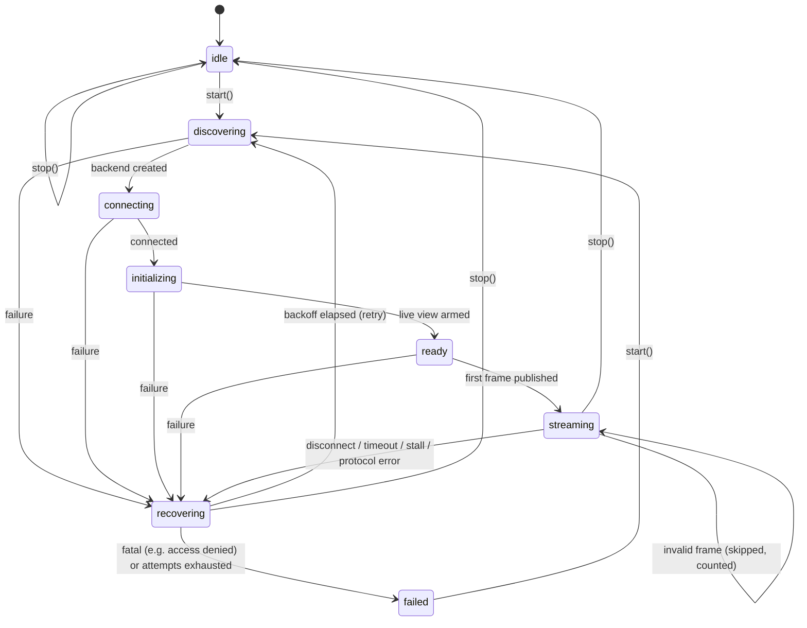

# Architecture

## Process boundaries

```mermaid
flowchart LR
    subgraph Camera["Camera (USB, PTP)"]
    end
    subgraph System["macOS"]
        PTPD["ptpcamerad<br/>(owns USB PTP interface + session)"]
    end
    subgraph App["Mirrorup.app (menu bar, unsandboxed)"]
        ICT["ImageCapturePTPTransport"] --> SES["PTPSession<br/>(serial gate, TIDs)"]
        REG["CameraRegistry<br/>discovery → driver"] --> SES
        SES --> CAN["CameraBackend<br/>(e.g. CanonCamera actor)"]
        CAN --> ENG["CaptureEngine<br/>state machine + recovery"]
        ENG --> DEC["FrameDecoder<br/>VideoToolbox JPEG → 1280×720 420v"]
        DEC --> BUF["LatestFrameBuffer<br/>(1 slot)"]
        BUF --> SINK["VirtualCameraSink<br/>CMIO sink queue"]
        BUF --> PREV["Preview"]
    end
    subgraph Ext["Mirrorup Camera Extension (system extension, sandboxed)"]
        SNK["sink stream"] --> REL["FrameRelay<br/>newest frame only"]
        REL --> SRC["source stream<br/>'Mirrorup Camera'"]
    end
    Clients["FaceTime · Safari · Zoom · Teams · OBS · QuickTime"]
    Camera <-->|USB bulk| PTPD
    PTPD <-->|requestSendPTPCommand| ICT
    SINK -->|IOSurface-backed CMSampleBuffer| SNK
    SRC --> Clients
```

- **Exactly one process owns the camera:** the app. The Camera Extension never touches USB or
  ImageCaptureCore; it can't start capture by itself and shows a "camera not connected" frame
  until the app feeds it. That frame is drawn mirrored so it reads correctly in mirrored
  self-views (Photo Booth, FaceTime, Zoom); live frames are never mirrored by the extension.
- **Transport:** `ptpcamerad` owns the USB interface, so the app sends PTP through
  ImageCaptureCore's pass-through (see `usb-feasibility.md`). A direct IOUSBHost transport exists
  for when the interface is free and is exercised by the same PTP stack.
- **App → extension IPC:** CoreMediaIO's own sink/source design. The app enqueues `CMSampleBuffer`s
  on the extension's sink stream (`CMIOStreamCopyBufferQueue`). The pixel buffers are
  IOSurface-backed, so they cross the process boundary without copying pixels. There is no custom
  XPC or shared-memory code. CoreMediaIO fans the source stream out to any number of client apps.
- **Device name:** one device with a fixed device ID (apps remember it), named after the selected
  source: "<camera name> (Mirrorup)", "Test Pattern (Mirrorup)", or "Mirrorup Camera" before any
  camera has connected. The camera source keeps the last camera's name while it is off, so USB
  dropouts never rename it. The app sets the name through a custom device property; the extension
  renames by replacing the device (same device ID, new streams) and remembers the name across
  restarts. The app stops its sink first and postpones the rename while another app streams.
- **Extension upgrades:** the extension has its own build number, which changes only when its sources
  do (`macOS/extension-version.sh`), so app-only updates leave a running extension alone. When it
  changes, the app activates the embedded extension and relaunches itself, because a CoreMediaIO
  client doesn't see the replacement process; after the relaunch it tells the user to reopen video
  apps. macOS 27.2 can lose the job of an extension replaced while running (see `AGENTS.md`); the
  relaunched app then reports that a restart is needed.
- **USB health:** the capture status counts connections lost while streaming; three within ten
  minutes (`ConnectionStability`) make the popover say the cable, adapter or port is at fault,
  naming a hub in the path when the USB location ID shows one. A supported camera on USB that
  Image Capture doesn't list is reported as connected but not responding.

## Modules (Swift package)

| Module | Responsibility | Concurrency |
|---|---|---|
| `MirrorupPTP` | Value-type containers and codec. `PTPSession` actor serialises transactions through `AsyncSerialGate` (actors are re-entrant across `await`), assigns transaction IDs and maps response codes to `PTPError`. `PTPUSBTransport<Pipe>` adds USB framing: multi-packet reassembly, ZLPs, length limits checked before allocation, TID/opcode checks. | actor + Mutex |
| `MirrorupUSB` | IORegistry discovery, descriptor parsing, `IOUSBHostBulkPipe` (async enqueue, abort on cancel, interest handler for removal). | `@unchecked Sendable`, documented |
| `MirrorupImageCapture` | `ImageCaptureBrowser` (main actor; ImageCaptureCore calls back on main) and `ImageCapturePTPTransport`: each request races its own deadline and task cancellation, and device removal fails the in-flight request immediately. | MainActor + Mutex |
| `MirrorupDevices` | Vendor-neutral discovery over both transports (`CameraDiscovery`, `DiscoveredCamera`, `CameraTransport`), the `CameraDriver` protocol, `CameraRegistry` (first supporting driver wins; names attached-but-unsupported cameras in the not-found error), and the shared `PTPError` → `CameraError` mapping. | MainActor hops for ImageCaptureCore |
| `MirrorupCameras` | `CameraRegistry.builtIn`: the drivers the app and CLI ship. The only module that knows every driver. | — |
| `MirrorupCanon` | `CanonDriver` (claims Canon PTP devices) and the `CanonCamera` actor: init sequence, live-view arming through `0xD1B0`, the GetViewfinderData poll loop with not-ready retries, periodic GetEvent drain, KeepDeviceOn, and re-arming when the user leaves PC live view. EVF payload and GetEvent parsers. | actor |
| `MirrorupCapture` | `CameraBackend` contract, the pure `CaptureStateMachine`, `CaptureEngine`/`CaptureLoop` (recovery with exponential backoff and jitter, stall watchdog, deadlines), `FrameDecoder`, `LatestFrameBuffer`, `FrameMetrics`, `SyntheticCamera`. | actor + `@concurrent` loop |
| `MirrorupDiagnostics` | OSLog categories, signposts, `HostTime`, bounded `SampleWindow`. | — |

Errors are layered. `PTPTransportError` (I/O) is wrapped by `PTPError` (protocol); drivers map both to
`CameraError` (`CameraError(ptp:context:)` covers the generic cases, drivers override where they know
better, e.g. Canon's live-view refusals). `CameraError` carries a plain-language `message`, a diagnostic `detail`
and a `disposition` (skip frame / reconnect / wait for device / fatal / stop) that drives recovery.

## Camera metadata

Every value the camera reports is decoded once, in the vendor layer, into the vendor-neutral
`CameraMetadata` model (`MirrorupCapture/CameraMetadata.swift`): sections (`SectionKind`) of items
keyed by `ItemKind` (an enum; neutral kinds such as `.aperture`, `.lensName`, `.focusPoints`, plus
`.vendorProperty(code)` / `.vendorFrameBlock(type)` for vendor codes without a neutral meaning). Each
item carries the human value, the raw protocol value, the allowed values, and whether any public
source documents it.

- **Camera-wide:** `CameraBackend.metadata()`, read on demand through
  `CaptureEngine.cameraMetadata()` (popover open, Camera Info window, diagnostics export); nothing
  polls it. `CanonCamera` combines DeviceInfo (identity, capabilities named through
  `PTPCatalog`/`CanonCatalog`) with every GetEvent property and allowed-value list.
- **Per frame:** `CanonViewfinderParser` parses every block of each live-view payload into
  `CanonViewfinderMetadata` (cheap, no formatting); `metadata()` formats the latest frame's blocks
  into the `.frame` section when asked.
- **Consumers:** the app's Camera window and the CLI's text output show `documentedOnly`. `mirrorup camera info --json`, the snapshot sidecar and the
  diagnostics export keep everything, including undocumented codes.

## Camera controls

`CameraControlling` (`MirrorupCapture/CameraControls.swift`) is an optional backend capability:
settings (`CameraSetting`: aperture, shutter, ISO, brightness/exposure compensation, white balance,
colour temperature, image style, AF method) with the options the camera currently allows and the
maker's own label for each (`CameraSettingState.title`, e.g. Canon's "Picture Style"), autofocus,
focus at a point, live-view zoom at the factors the camera offers (`zoomLevels`), photo capture, and
user-facing hints in the camera's own terms (`hint`, `photoUnavailableReason`). The app has no
vendor wording of its own. `CaptureEngine.controls()` returns the
active backend when it conforms. `CanonCamera` implements it with Canon PTP commands (see
`canon-eos-ptp.md`, Controls); the commands go through the same `PTPSession` gate as frame polling,
so they interleave safely with streaming.

- Control state is read on demand only: when the popover opens and after each change.
- Points are normalized to the camera's live-view frame. The app maps a click on the 16:9 preview
  back to that frame by undoing mirroring/rotation (`FrameOrientation.cameraPoint`) and the centre
  crop.
- Enhance (opt-in, Apple silicon) swaps the decoder's scaling for a machine-learning upscale:
  the decompression session decodes into the 16:9 crop at camera resolution in the scaler's
  source format, `VTLowLatencySuperResolutionScaler` enlarges it 1.5×, and one pixel transfer
  scales to 1280×720. The scaler is built on a background queue; until it is ready, and for crop
  sizes it rejects, frames use plain scaling. Toggled with `CaptureEngine.setEnhance`.
- Mirror and upside down are app-side (`CaptureEngine.setOrientation`), applied after decoding with
  `VTPixelRotationSession`, and skipped entirely when off.

## Capture state machine

Every transition goes through `CaptureStateMachine.handle(_:)`, a pure value-type reducer with a
test per transition. There are no ad-hoc flags. Each engine run has a generation number, so late
events from a cancelled loop are ignored.

## Frame flow and timing

Steps 1–2 are Canon's; other drivers produce the same `CameraFrame` (a baseline JPEG slice and two
host timestamps) their own way.

1. `CanonCamera.nextFrame()` polls `GetViewfinderData`. The first byte request is stamped
   `acquisitionStart` (host time). Not-ready replies (`0xA102`) are retried every 3 ms.
2. The payload is parsed in place. The JPEG is a `Data` slice of the transfer buffer and is never
   copied. `acquisitionEnd` is stamped when the transfer completes; this is the frame's capture time.
3. `FrameDecoder` wraps the JPEG bytes in a `CMBlockBuffer` without copying. VideoToolbox decodes it
   (hardware where available) and scales/crops it in one pass into a pooled IOSurface-backed 1280×720
   `420v` buffer.
4. `LatestFrameBuffer.publish` replaces any unconsumed frame (counted as a drop) and wakes waiters.
5. The app forwards the frame to the CMIO sink queue. If the queue is full it drops the frame; it
   never blocks. The frame also goes to the preview, which keeps only the newest frame.
6. The extension forwards each new sink frame to the source stream as soon as it arrives. A 30 Hz
   timer only fills gaps (repeats the last frame, or shows the fallback when the app is silent for
   more than 500 ms), so clients get a steady stream without the extension adding a frame interval
   of latency.

All timestamps are `mach_absolute_time` host time, the clock behind `CMClockGetHostTimeClock()`, so
values compare directly across the app/extension boundary. Frame age at delivery =
`delivery − acquisitionEnd`. That measures processing latency, not glass-to-glass latency: the camera's
exposure, its encoding and its internal buffering happen before `acquisitionEnd`, and the clients'
render path after delivery is not measured.

## Why these choices

- **ImageCaptureCore instead of IOUSBHost/DriverKit:** it is the only supported path while `ptpcamerad`
  runs, and it measured 29.8 fps with ~15 ms acquisition. DriverKit would need Apple-granted
  entitlements and would replace the system driver.
- **Polling, not events, for frames:** the camera exposes no frame-ready event. Fast polling with a
  short retry keeps frames fresh. About 70% of polls return not-ready at the camera's ~30 fps cadence.
  Polls cost ~1 ms each and CPU stays around 6.5% of one core (see `performance.md`).
- **Single-slot buffers everywhere:** latency is bounded by construction. A slow consumer loses frames
  instead of accumulating delay.
- **One fixed output format (1280×720 '420v' @ 30):** the extension advertises only what it can
  always produce. The camera's 960×640 or 1024×576 frames are aspect-filled and centre-cropped into it.
